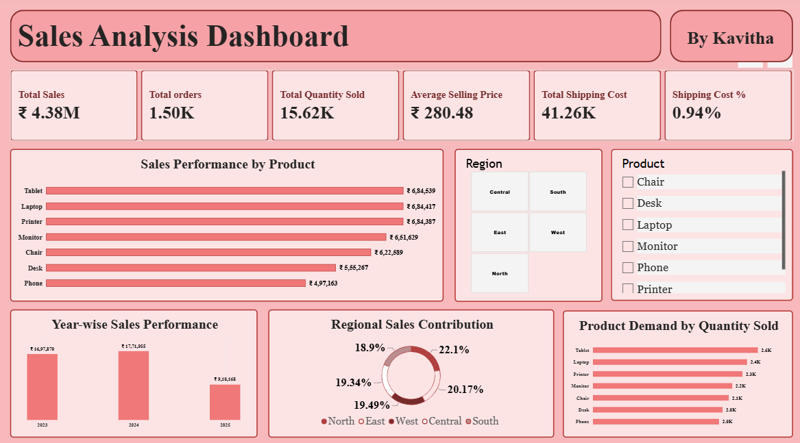
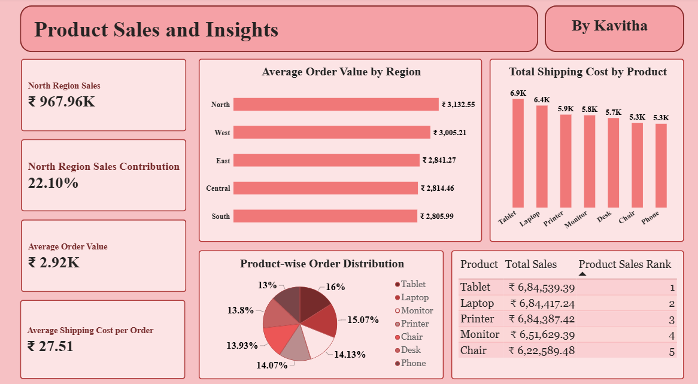

# Power BI Sales Analysis Dashboard

## Project Overview
Developed an interactive two-page Power BI dashboard to analyze sales performance, product demand, regional sales, order distribution, and shipping costs.

## Tools & Technologies
- Microsoft Power BI
- Power Query
- DAX (Data Analysis Expressions)
- Microsoft Excel

## Dashboard Pages

### Page 1 — Sales Overview
- Total Sales, Total Orders, and Total Quantity Sold
- Average Selling Price and Shipping Cost KPIs
- Product-wise Sales Performance
- Year-wise Sales Analysis
- Regional Sales Contribution
- Product Demand Analysis
- Interactive Region and Product Slicers

### Page 2 — Product & Sales Insights
- Top 5 Products Ranking
- North Region Sales and Sales Contribution
- Average Order Value by Region
- Product-wise Shipping Cost Analysis
- Product-wise Order Distribution
- Average Shipping Cost per Order

## DAX Functions Used
- `SUM()` — Calculate total sales, quantity, and shipping costs
- `DISTINCTCOUNT()` — Calculate unique orders
- `DIVIDE()` — Calculate average order value and percentages
- `CALCULATE()` — Analyze sales under specific filter conditions
- `RANKX()` — Rank products by sales
- `REMOVEFILTERS()` — Calculate sales contribution against the overall total

## Dashboard Preview

### Sales Overview

### Product & Sales Insights

## Key Learnings
- Data cleaning and transformation using Power Query
- Creating calculated measures using DAX
- Designing interactive dashboards with slicers
- Analyzing sales and product performance
- Presenting business insights through visualizations

## Author
Kavitha | Aspiring Data Analyst
